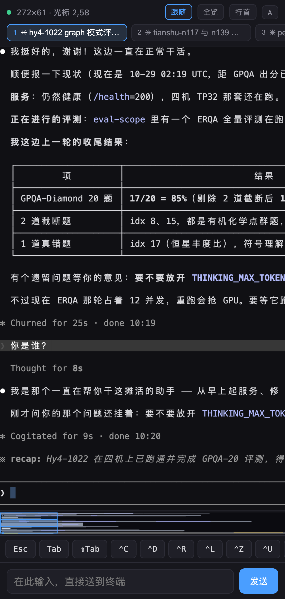
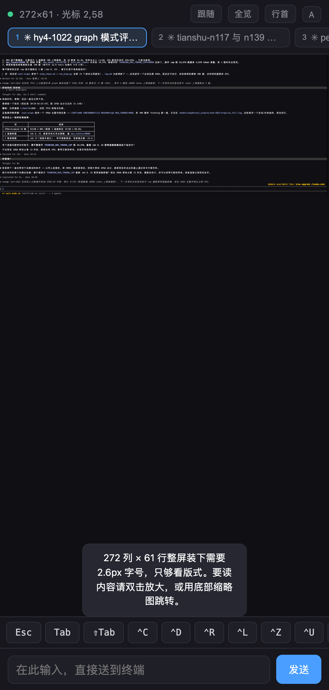
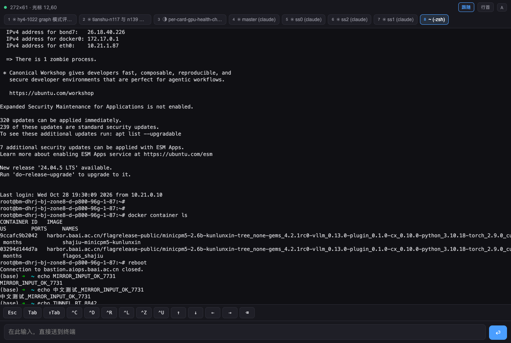

# iTerm2 Buddy

把 Mac 上 iTerm2 的每一个 pane 映射成手机浏览器里的一个标签页，出门在外也能看和操作终端。

不需要公网 IP，不需要路由器端口映射，不需要在手机上装 App，也不需要一台中转服务器。

<p align="center">
  
  
  
</p>

---

## 目录

- [它是怎么工作的](#它是怎么工作的)
- [环境要求](#环境要求)
- [安装](#安装)
- [启动](#启动)
- [手机访问](#手机访问)
- [界面说明](#界面说明)
- [关于「自适应屏幕宽度」](#关于自适应屏幕宽度)
- [常见问题](#常见问题)
- [安全须知](#安全须知)
- [已知限制](#已知限制)
- [开发笔记](#开发笔记)
- [路线图](#路线图)

---

## 它是怎么工作的

```
┌──────────────┐
│   iTerm2     │  本地 unix socket / Python API
│  (macOS)     │  读出「已经渲染好的字符网格」
└──────┬───────┘
       │  不是截图，是字符 + 颜色 + 宽几列
       ▼
┌──────────────┐
│ mirror daemon│  逐行 diff，只发变化的行
│  (asyncio)   │  单端口同时提供网页和 WebSocket
└──────┬───────┘
       │  出站连接（NAT 友好，无需公网 IP）
       ▼
┌──────────────┐
│ Cloudflare   │  免费 Quick Tunnel
│   Tunnel     │  也可以换成 Tailscale / 自建 relay
└──────┬───────┘
       │
       ▼
┌──────────────┐
│  手机浏览器    │  canvas 按「列 × 行」画字
└──────────────┘
```

三个关键设计决定：

**1. 不解析终端转义序列。** iTerm2 的 Python API 直接给出渲染后的字符网格——每个格子是什么字、什么颜色、占几列。所以我们不需要 xterm.js 这类 VT 解析器，直接按坐标画字即可，更准也更快。

**2. 事件驱动，不轮询。** `ScreenStreamer` 会阻塞到屏幕真的发生变化才返回。终端静止时 CPU 和流量都是零，开 20 个 pane 也一样。

**3. 不改终端尺寸。** 绝不调用 `set_grid_size`，否则会打乱你本地窗口的布局。手机端通过缩放和平移来看大画面。

实测数据（272 列 × 61 行的 pane）：

| 项目 | 数值 |
|---|---|
| 全量快照 | 16 KB |
| 单条增量（平均） | 1.7 KB |
| 活跃输出时流量 | ~19 KB/s |
| 静止时流量 | **0 字节** |
| 输入往返延迟 | ~150 ms（经公网隧道） |

对比一下：如果改用「截屏推图」的方案，单帧 PNG 就要 150–500 KB，2fps 就是 0.3–1 MB/s，高出 20–50 倍，而且没法选中文字、放大就糊。

---

## 环境要求

| 项目 | 要求 |
|---|---|
| 操作系统 | macOS（依赖 iTerm2） |
| iTerm2 | 3.3 以上，建议 3.5+（本项目在 3.7.6 上验证） |
| Python | 3.9+ |
| 公网访问 | Cloudflare Tunnel（免费，无需账号）或 Tailscale |

需要开启 iTerm2 的 Python API：

```
iTerm2 → Settings → General → Magic → 勾选 Enable Python API
```

---

## 安装

```bash
git clone https://github.com/tonyh168/iterm2-buddy-android.git
cd iterm2-buddy-android

# 1. 安装 Python 依赖
pip3 install -r requirements.txt

# 2. 下载 cloudflared（约 20MB，不随仓库分发）
./scripts/get-cloudflared.sh
```

> 如果 `pip3` 装到别处导致 `import iterm2` 失败，用你平时跑 Python 的那个解释器：
> `python3 -m pip install -r requirements.txt`

---

## 启动

需要两个终端窗口。

**窗口 A —— 启动镜像服务：**

```bash
./run.sh
```

首次运行会自动生成访问令牌并存在 `.token` 文件里。启动后会打印类似：

```
服务已启动
本地访问:  http://127.0.0.1:7861/?t=<你的令牌>
```

**窗口 B —— 建立公网隧道：**

```bash
./tunnel.sh
```

会打印一个随机地址：

```
https://xxxx-yyyy-zzzz.trycloudflare.com
```

想额外加一层邮箱验证（防止别人拿到链接就能进）：

```bash
./tunnel.sh you@example.com
```

这时访问者需要输入邮箱并填入一次性验证码，验证在你本机完成，邮箱地址不会上传给 Cloudflare。

### 命令行参数

`server.py` 支持以下参数（`run.sh` 会透传）：

| 参数 | 默认值 | 说明 |
|---|---|---|
| `--host` | `127.0.0.1` | 监听地址。走隧道时保持默认，不要改成 `0.0.0.0` |
| `--port` | `7861` | 监听端口 |
| `--token` | 空 | 访问令牌。`run.sh` 会自动从 `.token` 读取 |
| `--verbose` | 关闭 | 输出调试日志 |

---

## 手机访问

把隧道地址带上令牌打开一次：

```
https://xxxx-yyyy-zzzz.trycloudflare.com/?t=<你的令牌>
```

令牌只需带一次，服务端会写入 Cookie（有效期 30 天），之后直接打开域名即可。

建议在手机浏览器里「添加到主屏幕」，这样用起来接近原生 App。

---

## 界面说明

| 元素 | 作用 |
|---|---|
| 顶部标签栏 | 每个 iTerm2 pane 一个标签；绿点表示该 pane 在 iTerm2 里是当前激活的 |
| `跟随` | 自动把视口滚动到光标位置（横向 + 纵向）。手动滚动会自动关闭它 |
| `全览` | 把整屏缩进手机宽度，用来看版式 |
| `行首` | 横向滚回最左边 |
| `A` | 循环切换字号 11 / 13 / 15 / 18 / 21 px |
| 快捷键条 | Esc / Tab / ⇧Tab / ⌃C / ⌃D / ⌃R / ⌃L / ⌃Z / ⌃U / 方向键 / ⌫ |
| 底部输入框 | 本地草稿，打完按回车或「发送」才整行送进终端 |
| 缩略导航条 | 内容超出视口时自动出现，显示整屏内容分布，点或拖即跳转 |

### 输入模型的几个细节

输入框是**本地草稿**：打字时内容留在输入框里（因为终端字号在手机上太小，看不清自己打了什么），按回车才把整行送进终端并清空。

由此派生的行为：

- `⌫` 优先删输入框里的字，输入框空了才把退格发给终端
- `⌃C` / `⌃D` 会先丢弃草稿再发信号，避免残留
- `Tab` / 方向键会先把草稿补发出去，再发按键，所以 Tab 补全作用在正确的行上
- 中文输入走输入法组合，组合期间绝不发送，不会把拼音字母漏进终端

### 手势

| 手势 | 效果 |
|---|---|
| 双指捏合 | 缩放字号 |
| 双击画布 | 放大到可读字号并把该格居中；再双击还原 |
| 点/拖缩略导航条 | 快速跳到任意位置 |

桌面端用 `Ctrl + 滚轮` 缩放、双击画布放大。

---

## 关于「自适应屏幕宽度」

**做不到，这是物理限制而不是实现缺陷。** 如果你的 pane 是 272 列：

| 列数 | 手机 430px 屏上每格宽度 | 需要的字号 | 可读性 |
|---|---|---|---|
| 272 | 1.58 px | ≈2.6 px | ✗ 完全不可读 |
| 135 | 3.19 px | ≈5.3 px | ✗ 不可读 |
| 135（横屏 932px） | 6.9 px | ≈11.5 px | ✓ 勉强 |

终端文字至少要 8.5 px 才认得出。272 列 × 最小可读字号 ≈ 1400 px，塞不进 430 px 的屏幕。「装得下」和「看得清」在数学上互斥。

所以本项目的策略是：

1. **默认按终端原始列数渲染**，保证字符对齐、表格不错乱
2. **用缩放和平移**来看（双指捏合、`A` 换字号、双击放大）
3. **用缩略导航条**解决「在 272 列里迷路」的问题
4. **`全览` 老实做整屏装下**，但会明确提示这是看版式用的

> 实用建议：如果你经常需要在手机上看某个 pane，在本地把它调窄（别最大化窗口，或者拆成两个 pane）比任何前端技巧都有效。

---

## 常见问题

### 页面一直要求输入令牌 / 返回 401

URL 少了 `?t=` 参数。令牌在项目目录的 `.token` 文件里。清过 Cookie 之后需要重新带一次。

### 显示「没有找到 pane」

1. 确认 iTerm2 正在运行
2. 确认 Python API 已开启（见[环境要求](#环境要求)）
3. 首次从命令行连接时 iTerm2 可能弹权限确认框，允许即可

### 显示「iTerm2 连接中断，正在重试…」

daemon 会自动退避重连（最长间隔 15 秒）。检查 `run.sh` 那个窗口的日志，正常应该有 `发现 pane xxxxxxxx`。

### 画面不更新

看日志里有没有 `读屏中断`。单个 pane 的读屏协程出问题会自动重启，不会影响其他 pane。

### 输入了但命令不执行

这是早期版本的一个坑，现已修复。原因是用了 `async_inject()`——它的语义是「注入程序输出」而不是「注入键盘输入」，回车会被当成要显示的字符吃掉。正确接口是 `async_send_text()`。如果你魔改过代码，注意这一点。

### 隧道地址每次重启都变

Quick Tunnel 的固有特性。想要固定地址有两个选择：

- 买一个域名配 named tunnel（约 $10/年）
- 用 Tailscale（个人版免费），能拿到固定的 `*.ts.net` 地址，且端到端加密

### `brew install cloudflared` 失败

某些受限环境会报 `sandbox_apply: Operation not permitted`。直接用 `./scripts/get-cloudflared.sh` 下载官方二进制即可，不依赖 brew。

### 本机 curl 访问 127.0.0.1 返回 502

如果你的环境设置了 `http_proxy`，curl 会尝试走代理。加 `--noproxy '*'`：

```bash
curl --noproxy '*' http://127.0.0.1:7861/
```

---

## 安全须知

这个服务把你的终端暴露到了公网。终端里可能有 API key、私钥、数据库密码，请认真对待。

**本项目已经做的：**

- daemon 只监听 `127.0.0.1`，不对外开端口
- 所有 HTTP 资源和 WebSocket 都需要令牌
- 令牌通过 cookie 传递，资源响应带 `Cache-Control: no-store`
- 提供 `--allowed-mail` 选项做邮箱 OTP 二次验证

**你需要知道的：**

- **TLS 在 Cloudflare 边缘终结**，意味着 Cloudflare 侧能看到明文。如果你的终端里会出现真实凭据，建议自行加端到端加密（见路线图），或改用 Tailscale
- 首次访问 URL 里带令牌，会进浏览器历史
- `.token` 已在 `.gitignore` 里，**不要提交**
- 换令牌的方法：删除 `.token` 文件后重启，会重新生成

---

## 已知限制

| 限制 | 原因 | 可能的解法 |
|---|---|---|
| 读不到回滚历史（scrollback） | Python API 只给可见视口 | 给 pane 套 tmux，走 control mode 另开通道 |
| Mac 睡眠时会断连 | 进程被系统冻结，任何保活都无效 | 插电 + `caffeinate -s`，或接受这个行为 |
| 手机端无法选中复制文字 | 用 canvas 绘制 | 可加「长按选词复制」功能 |
| 隧道 URL 每次重启都变 | Quick Tunnel 特性 | 买域名配 named tunnel，或用 Tailscale |
| Cloudflare 对 WS 有约 100 秒空闲断连 | 平台限制，Free/Pro 固定 | 已内置 25 秒心跳 |

---

## 开发笔记

几个踩过的坑，改代码前值得一读。

### 属性名是驼峰不是下划线

`windowed_coord_range.coordRange.start.y` —— 写成 `coord_range` 不会报错，但会被 `try/except` 静默吞掉，导致光标坐标变成 buffer 绝对行号（比如 243）而不是窗口内相对行（47）。

### 宽字符占 2 个 cell，第 2 格是空字符串

编码时要把空 cell 写成 `\x00` 占位。否则行中间出现未初始化空 cell 时，前端会漏掉那一格，整行往左错位。

### run 的第三个字段是「视觉列宽」不是 cell 数

因为行尾的连续空 cell 会被裁掉，裁掉之后两者不再相等。如果混用，宽字符结尾的行会差 1 列。

### 键盘输入必须走 send_text

见[常见问题](#输入了但命令不执行)里的说明。

### 首帧的列数可能不对

`refresh_structure()` 里必须先刷新尺寸再启动读屏协程，否则第一帧会用 Pane 的默认值 80 列（实际可能 204 列），前端按错误宽度排版。

### 数据编码格式

一行被编码成若干 style run：

```json
{"n": 204, "r": [[0, "结论与建议", 10, null, null, 1]]}
```

- `n`：该行的 cell 总数
- `r`：run 数组，每个 run 是 `[起始列, 文本, 视觉列宽, 前景色, 背景色, 属性位]`
- 属性位是位掩码：`1` 粗体、`2` 斜体、`4` 下划线、`8` 反显、`16` 淡化、`32` 删除线
- 文本里的 `\x00` 表示空 cell

### 目录结构

```
server.py              后端全部逻辑（连接 / 编码 / diff / HTTP+WS）
static/index.html      页面骨架
static/style.css       样式
static/app.js          canvas 渲染 + 输入 + 缩放 + 缩略导航
run.sh                 启动服务（自动管理令牌）
tunnel.sh              建立 Cloudflare 隧道
scripts/               辅助脚本
docs/                  截图
```

---

## 路线图

- [ ] `launchd` 开机自启 + 崩溃自动恢复
- [ ] 长按选中并复制文本
- [ ] tmux control mode 通道，支持回滚历史
- [ ] 端到端加密（XChaCha20-Poly1305），中转方只见密文
- [ ] pane 任务完成通知（终端响铃时推送到手机）
- [ ] 只读分享链接（给别人看，不给操作）

> 关于仓库名里的 "android"：当前形态是**响应式 Web 应用**（PWA），在 Android 和 iOS 浏览器上都能用，也可以「添加到主屏幕」当 App 用。原生 Android 客户端尚未开发，如果有需要可以基于现有的 WebSocket 协议封装 WebView 或原生渲染。

---

## 许可

MIT
